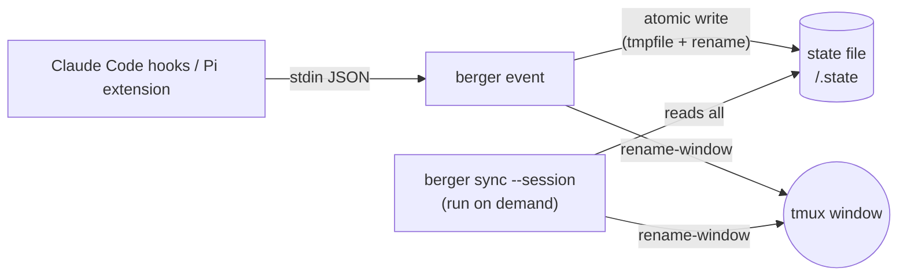

# berger

Make tmux sessions agent-aware from Claude Code and Pi lifecycle events.

Claude Code hooks or a Pi extension call `berger event`, which writes a state file
and renames the current tmux window to show the agent's status as a suffix — no
background process involved.

```
1:main  2:plan  3:impl!  4:review✓  5:tests✗
```

## Symbols

| State    | Symbol | Meaning                |
|----------|--------|------------------------|
| working  | _(none)_ | Busy, no action needed |
| approval | `!`    | Needs your input        |
| done     | `✓`    | Agent run settled       |
| error    | `✗`    | Hook, tool, or aborted run error |

## Quick start

```bash
cargo install --path . --root ~/.local
berger init                       # Claude Code (default)
berger init --harness pi          # Pi
```

Run both initialization commands if you use both harnesses. `init` wires everything up:

- For Claude Code, rewrites `~/.claude/settings.json` so all 8 lifecycle hooks call
  `berger event`, leaving unrelated hooks untouched.
- For Pi, writes the supported global extension
  `~/.pi/agent/extensions/berger.ts`, leaving other extensions and configuration
  untouched. It refuses to overwrite an unmanaged `berger.ts`.
- Re-running either form is idempotent.
- Writes `~/.config/berger/tmux.conf` (berger's own settings — `allow-rename off`,
  `automatic-rename off`, and a `prefix + M` binding that runs `berger sync`).
  Prints the one line to add to your `~/.tmux.conf`:

  ```tmux
  source-file ~/.config/berger/tmux.conf
  ```

- Creates the state cache root.

Then name your tmux windows to match agent roles:

```bash
tmux rename-window impl
tmux rename-window plan
```

When Claude Code or Pi runs in one of these windows, the suffix updates as lifecycle events fire.

## Event → state mapping

| Harness | Event | State | Symbol |
|---|---|---|---|
| Claude | `SessionStart`, `UserPromptSubmit`, `PreToolUse` | `working` | _(none)_ |
| Claude | `PermissionRequest` | `approval` | `!` |
| Claude | `PostToolUseFailure`, `StopFailure` | `error` | `✗` |
| Claude | `Stop` | `done` | `✓` |
| Claude | `SessionEnd` | _(state file deleted)_ | _(suffix cleared)_ |
| Pi | `agent_start` | `working` | _(none)_ |
| Pi | `ui_prompt_start` during an agent run | `approval` | `!` |
| Pi | `ui_prompt_end` during an agent run | `working` | _(none)_ |
| Pi | `tool_execution_end` when `isError` | `error` | `✗` |
| Pi | `agent_settled` when not aborted and no failed tool was observed | `done` | `✓` |
| Pi | `agent_settled` after an aborted run or a failed tool | `error` | `✗` |
| Pi | `session_shutdown` with reason `quit` | _(state file deleted)_ | _(suffix cleared)_ |

Pi reports `done` only when the run was not aborted and no failed tool was observed;
provider failures without either signal are not observable to this extension. Reloads,
session replacements (`new`, `resume`, `fork`), and their following `session_start` do
not change the current marker: Pi tears down the old extension
before loading the replacement, so clearing on those shutdowns would incorrectly
lose the window status. A subsequent agent lifecycle event updates it. Unknown Pi
events and unknown harnesses are ignored. Pi does not expose an exact equivalent
for every Claude Code transition, so its status mapping is intentionally limited to
the reliable extension events above.

`berger event` never exits non-zero — it sits on Claude Code's hook path, where a
failing exit code can block a tool call or prompt, so a berger bug must never be
able to interfere with your session. Errors go to stderr; the event is a no-op.

Running outside tmux (a plain terminal, an IDE, CI) is a normal condition, not an
error — `event` returns without doing anything tmux-related.

## Manual usage

```bash
# Reconcile every window in a session against its state files — useful if a
# rename was missed or a window name drifted. Bound to prefix + M by init.
berger sync --session myproject

# Clear berger's runtime state
berger reset
```

There is no `watch`/daemon: state only changes when a hook fires, so `event`
renames the window in the same invocation. `sync` is the on-demand repair path
for anything that falls out of sync in between.

## Testing

Unit tests live alongside the Rust source (`cargo test`). The smoke suite in
`tests/smoke_test.py` drives a real, throwaway tmux server end-to-end —
build the binary first, then run it. Pi runtime smoke tests require Node 22.6+
for `--experimental-strip-types`; they are skipped when that version is unavailable:

```bash
cargo build
python3 tests/smoke_test.py          # run everything
python3 tests/smoke_test.py -v       # verbose

# run a single test
python3 tests/smoke_test.py SmokeLifecycle.test_permission_request_adds_bang

# opt-in: also exercise a real `claude` session through the installed hooks
BERGER_TEST_REAL_CLAUDE=1 python3 tests/smoke_test.py
```

Each test spins up an isolated `tmux -L berger-test-<pid>-<n>` server with its
own `HOME`/`XDG_CACHE_HOME` and a `tmux` PATH shim — your real tmux server and
config are never touched. See `tests/harness/sandbox.py` for details.

## Per-window agent name

Agent name is resolved from the current tmux window name (suffix stripped), or
`$BERGER_AGENT` if set, or `basename $PWD` as a last resort:

```bash
export BERGER_AGENT=impl
claude
```

## File locations

| What | Path |
|---|---|
| Binary | `~/.local/bin/berger` |
| tmux config | `~/.config/berger/tmux.conf` (sourced from your `~/.tmux.conf`) |
| Claude Code hooks | `~/.claude/settings.json` |
| Pi extension | `~/.pi/agent/extensions/berger.ts` |
| State files | `$XDG_CACHE_HOME/berger/<session>/<agent>.state` (default `~/.cache/berger/...`) |

## Architecture



`berger event` is short-lived: read stdin, write state, exit — nothing stays running
between hooks. `berger sync` reads every state file for a session and reconciles any
window that has drifted; run it manually, or bind it to a tmux key (`init` does this
by default).

State files are plain key=value text — no JSON, no jq required.

## Troubleshooting

- **Window names not updating**: check that `allow-rename off` and
  `automatic-rename off` are set (via `~/.config/berger/tmux.conf`, sourced from
  your `~/.tmux.conf`).
- **A name looks stale**: run `berger sync --session <name>` to reconcile.
- **State files**: `ls $XDG_CACHE_HOME/berger/<session>/` (default
  `~/.cache/berger/<session>/`).

## Migrating from amux

Superseded by berger; the original bash prototype is kept in `legacy/` for
reference. Berger does not modify amux configuration or runtime state.
